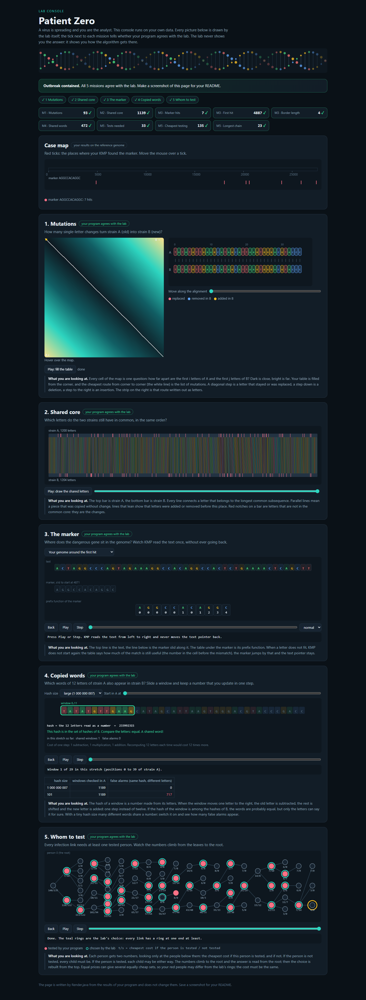

# Assignment 4. Patient Zero

Student ID: **251554**  
Name: **Dinmukhamed Tamdybek**  
Group: **SE-2512**

**Персональный вариант 251554.** Файлы в `data` сгенерированы штатным `MakeVariant.java` с Student ID `251554`. Результаты, HTML и скриншот относятся к этому персональному набору.

## Запуск в VS Code

1. Открыть **File → Open Folder → DAA4**: папку, содержащую `src` и этот README.
2. Нужен JDK 17 или новее: проверить `java -version` и `javac -version`.
3. Для Run/Debug установить рекомендуемый **Extension Pack for Java**. Для терминала расширение не требуется.
4. **Ctrl+Shift+B** запускает сборку и `Main`. Или открыть `src/Main.java` и нажать Run над `main`.
5. Открыть `output/outbreak.html` в браузере. Интернет и сервер не нужны.

Из терминала PowerShell в папке проекта:

```powershell
powershell -NoProfile -ExecutionPolicy Bypass -File .\run.ps1 run
powershell -NoProfile -ExecutionPolicy Bypass -File .\run.ps1 check
powershell -NoProfile -ExecutionPolicy Bypass -File .\run.ps1 bench
```

ExecutionPolicy применяется только к этому процессу. Также доступны задачи через **Terminal → Run Task**.

Обычные команды Java без скрипта:

```text
javac -encoding UTF-8 -d out src/*.java
java -cp out Main
java tools/Check.java
java -cp out Bench
```

`Check.java` перезаписывает HTML последним примером, поэтому после него нужно снова запустить `Main`. `run.ps1 check` делает это автоматически.

## Персональный вариант

Персональные данные уже созданы. Для повторной генерации того же варианта выполнить задачу **DAA4: Generate personal variant and run**, введя `251554`, или команду:

```powershell
powershell -NoProfile -ExecutionPolicy Bypass -File .\run.ps1 generate "251554"
```

Команда заменяет четыре файла в `data`, пересобирает проект и обновляет `output/results.txt` и `output/outbreak.html`. Старый скриншот переносится в `output/outbreak-previous.png`.

Отчёт и скриншот уже обновлены для ID `251554`. При переходе на другой ID нужно также обновить имя и группу, девять строк ниже, значения в ответах Mission 2 и Mission 3 и скриншот `output/outbreak.png`. Алгоритмы менять не требуется.

## Program output

Персональный вариант `251554`, проверен 8 ноября 2026 года:

```text
Mutations: 93
Shared core: 1139
Marker hits: 7
First hit: 4887
Border length: 4
Shared words: 472
Tests needed: 33
Cheapest testing: 135
Longest chain: 23
```

Один проверочный запуск со стартом JVM занял 0,286 секунды. Веб-консоль независимо пересчитала результаты и подтвердила все пять миссий.



## Questions

### Mission 1

`d[i][j]` — минимальное число операций для превращения первых `i` букв A в первые `j` букв B. Границы равны `d[i][0]=i`, `d[0][j]=j`; внутри таблицы берётся минимум из удаления `d[i-1][j]+1`, вставки `d[i][j-1]+1` и замены/совпадения `d[i-1][j-1]+cost`, где cost равен 0 для одинаковых букв и 1 для разных. Последняя ячейка отвечает на вопрос для полных строк.

### Mission 2

Подпоследовательность сохраняет порядок букв, но допускает пропуски; подстрока должна быть непрерывной в обеих строках. В моём варианте LCS равна 1139, а одинаковых букв на одинаковых индексах только 395: вставки и удаления сдвигают индексы, сохраняя порядок многих общих букв. При совпадении последних букв DP берёт диагональ плюс 1, иначе максимум сверху и слева.

### Mission 3

`pi[i]` — длина самого длинного собственного префикса строки `p[0..i]`, который одновременно является её суффиксом. При несовпадении KMP переходит к `pi[j-1]`, сохраняя полезный суффикс уже прочитанного текста, поэтому указатель текста назад не двигается; такой же переход после полного совпадения позволяет находить перекрытия. Мой маркер `AGGCCACAGGC` имеет Border length 4: его начало и конец равны `AGGC`, а более длинной собственной границы нет.

### Mission 4

Разные слова могут иметь одинаковый хеш, поэтому совпадение хешей обязательно проверяется посимвольно. При большом числе коллизий для каждого окна A могут проверяться многие окна B, что даёт худшее время `O(n*m*k)`; при малом числе кандидатов и фиксированном `k=12` ожидается линейный проход. Каждая подходящая позиция A учитывается один раз, независимо от количества её вхождений в B.

### Mission 5

`take[v]` и `skip[v]` — минимальная стоимость покрытия рёбер поддерева при тестировании вершины v и без него: `take[v]=cost[v]+sum(min(take[c],skip[c]))`, `skip[v]=sum(take[c])` по детям c. Ответ — минимум в корне; при восстановлении нетестированный родитель заставляет тестировать ребёнка, а тестированный разрешает выбрать более дешёвое состояние. Жадный выбор по числу связей не учитывает цены: в звезде с тремя листьями центр стоимостью 10 дороже, чем три листа стоимостью 1 каждый.

## AI use

Использован **OpenAI Codex (ChatGPT)**: подготовлены реализации алгоритмов, комментарии, дополнительные тесты, конфигурация VS Code и черновик отчёта; инструмент также запускал проверки, измерения и сохранял скриншот. Код решения и ответы сгенерированы с помощью AI; это не заявление о самостоятельном написании студентом. Перед сдачей студенту нужно разобраться в решении, проверить и переработать ответы своими словами согласно правилам задания.

Источники постановки и инфраструктуры: предоставленный архив `patient-zero-starter_A4_lite.zip`, `docs/Assignment4.pdf`, `START_HERE.md`, `docs/Hints.md`. Код со сторонних сайтов или из книг не использовался. Исходные `Main.java`, `Input.java`, `Render.java`, `Generator.java`, `Bench.java`, `src/lab.html` и утилиты не изменены.

## Timing (Mission 7)

Фактический запуск неизменённого `Bench`, Windows, OpenJDK Temurin 25.0.1; среднее из трёх запусков. Полный вывод в `output/timing.txt`; ниже десятичная запятая заменена точкой.

| test | size | time, ms |
|---|---|---:|
| naive search | 20 000, pattern 2 000 | 47.5 |
| naive search | 40 000, pattern 2 000 | 107.6 |
| naive search | 80 000, pattern 2 000 | 226.2 |
| KMP | 20 000, pattern 2 000 | 5.1 |
| KMP | 40 000, pattern 2 000 | 1.6 |
| KMP | 80 000, pattern 2 000 | 0.9 |
| edit distance | 500 × 500 | 14.3 |
| edit distance | 1 000 × 1 000 | 12.6 |
| edit distance | 2 000 × 2 000 | 27.3 |
| edit distance | 4 000 × 4 000 | 111.2 |

При фиксированном шаблоне удвоение текста теоретически примерно удваивает время и наивного поиска `O(n*m)`, и KMP `O(n+m)`, но наивный метод делает значительно больше сравнений: здесь рост составил примерно 2.27 и 2.10 раза. Убывающие значения KMP и первый шаг edit distance отражают прогрев JVM/JIT и шум коротких измерений: по этим трём точкам нельзя надёжно оценить коэффициент роста KMP. Для edit distance удвоение обеих длин даёт вчетверо больше ячеек; последний переход показал `111.2/27.3 ≈ 4.07` раза.

## Complexity

Для сравнения строк и Rabin-Karp `n=|A|`, `m=|B|`; для поиска n — длина текста, m — длина маркера. k — длина окна, h — число вхождений, v — число вершин, C — число пар окон, фактически проверенных после совпадения хешей.

| algorithm | time | additional space | assumptions |
|---|---|---|---|
| Edit distance | `O(n*m)` | `O(n*m)` | Полная таблица, постоянное число переходов на ячейку. |
| LCS | `O(n*m)` | `O(n*m)` | Полная таблица, сравнение символов за O(1). |
| Prefix function | `O(m)` | `O(m)` | Суммарное число уменьшений указателя ограничено числом увеличений. |
| KMP | `O(n+m)` | `O(m+h)` | Включены префикс-функция и возвращаемые позиции, h <= n+1. |
| Rabin-Karp (shared words) | Ожидаемое `O(n+m+C*k)`, худшее `O(n*m*k)` | `O(m)` | Ожидаемое O(1) для HashMap; сохраняются все позиции B. При фиксированном k=12 и малом числе коллизий ожидается O(n+m). |
| Tree DP + reconstruction | `O(v)` | `O(v)` | Связное дерево, включён стек DFS. |
| Longest chain | `O(v)` | `O(v)` | Один DFS, две максимальные глубины на вершину; ответ в рёбрах. |
| Naive search (provided Bench) | `O(n*m)` | `O(1)` | Только сравнение времени, не реализация Mission 3. |

Для DP точная оценка с учётом пустых строк — `O((n+1)*(m+1))`. Для Rabin-Karp первый хеш требует O(k), каждый сдвиг окна O(1); арифметика long не переполняется при выбранных BASE и MOD.

## Validation

- Компиляция с `--release 17` прошла на JDK 25; отдельный запуск на JDK 17 не выполнялся.
- `Check.java`: tiny, small, dense — все 9 строк совпали в каждом примере.
- `AlgorithmTests`: 6630 проверок с фиксированными seed, независимыми простыми алгоритмами для строк, полным перебором покрытий и BFS из каждой вершины для диаметра.
- Проверены пустые строки, перекрытия, повторения, отсутствие совпадений, настоящая коллизия хеша, одиночные вершины, нулевые цены и суммы больше Integer.MAX_VALUE.
- Пустой шаблон соответствует всем границам текста; k <= 0 отклоняется с IllegalArgumentException (в задании k=12).
- Рекурсивные обходы рассчитаны на размер дерева из задания: около 100 вершин. Огромные цепочки вне этого ограничения могут исчерпать стек.

## Git and submission

Локальный репозиторий создан на ветке main с отдельными коммитами по миссиям. История создана в ходе работы Codex и не имитирует самостоятельную работу студента. GitHub remote не настроен, публикация и отправка в Moodle не выполнялись.

Перед сдачей:

- [x] Указать настоящие ID, имя, группу; сгенерировать персональные данные.
- [x] Обновить результаты, ответы о своём варианте и скриншот.
- [ ] Разобрать код и переработать ответы; сохранить достоверное описание использования AI.
- [x] Реализовать алгоритмы и пройти проверки примеров.
- [x] Добавить измерения, сложность и скриншот персонального варианта.
- [ ] Создать публичный GitHub-репозиторий, отправить main, проверить доступность ссылки.
- [ ] Прикрепить ссылку в Moodle до своего срока сдачи.
